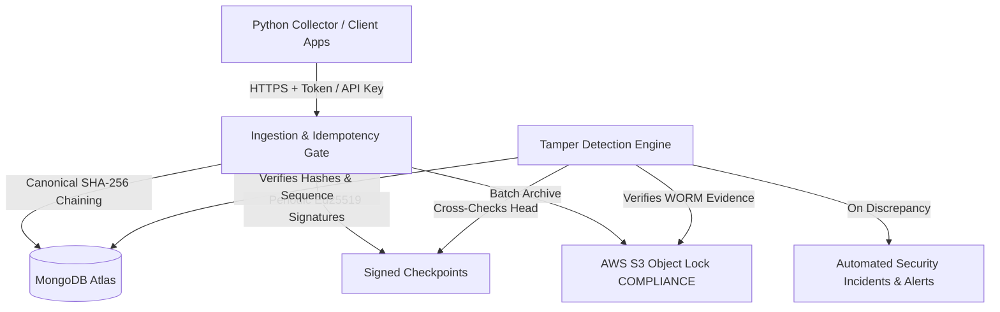

# HHH (Hash. Hunt. Harden.) – SecureLog Backend

Tamper-evident security logging, digital forensics, and cryptographic integrity platform.

---

## 1. System Architecture & Threat Model

### Root Compromise Defense (Why Hash Chaining Alone is Insufficient)
In traditional log systems, an attacker who obtains root access to the log ingestion server or MongoDB database can rewrite stored history, modify event contents, and recalculate mathematically valid SHA-256 hash chains from scratch. Recalculating a valid hash chain does **not** prove the original events were authentic.

To solve this, HHH SecureLog enforces **Three Layers of Defense**:
1. **Deterministic Canonical SHA-256 Hash Chaining**: Every log record binds `eventId`, `sourceId`, contiguous `sequenceNumber`, normalized `timestamp`, `message`, `metadata`, and `previousHash` using RFC 8785 canonical JSON serialization.
2. **Ed25519 Signed Checkpoints**: Periodically, the chain head is cryptographically signed using asymmetric Ed25519 private keys stored outside version control and off the logging database. A root attacker cannot forge valid Ed25519 signatures.
3. **AWS S3 Object Lock (Compliance Mode WORM)**: Immutable batch evidence storage where objects cannot be overwritten, deleted, or shortened even by the AWS account root or an attacker with full root access during the retention window.



---

## 2. Technology Stack

- **Runtime**: Node.js `v24.14.0` (ES Modules)
- **Framework**: Express.js `5.3.0`
- **Database**: MongoDB Atlas via Mongoose `9.12.2`
- **Security**: Helmet, CORS, bcryptjs (password hashing), jsonwebtoken (JWT), express-rate-limit
- **Cryptographic Primitives**: SHA-256, RFC 8785 Canonicalization, Ed25519 Asymmetric Signatures
- **Immutable Storage**: AWS S3 SDK (`@aws-sdk/client-s3`) Object Lock in COMPLIANCE mode + Local Mock Adapter
- **Testing**: Vitest `5.1.1` and Supertest `7.3.2`

---

## 3. Getting Started

### Prerequisites
- Node.js >= 18.0.0 (Node 20+ or 24 recommended)
- MongoDB instance or MongoDB Atlas connection string

### Environment Configuration
Copy `.env.example` to `.env`:
```bash
cp .env.example .env
```

Configure your environment variables:
```ini
PORT=5000
NODE_ENV=development
CLIENT_URL=http://localhost:5173
MONGODB_URI=mongodb+srv://<username>:<password>@cluster0.mongodb.net/securelog
JWT_SECRET=your_super_secret_256bit_key
JWT_EXPIRES_IN=24h
COLLECTOR_API_KEY=your_collector_secret_key

# Storage Mode: "mock" for local dev, "s3" for production
STORAGE_MODE=mock
AWS_REGION=us-east-1
AWS_ACCESS_KEY_ID=
AWS_SECRET_ACCESS_KEY=
AWS_S3_BUCKET=securelog-immutable-evidence
AWS_S3_RETENTION_DAYS=30
```

> [!IMPORTANT]
> When creating the AWS S3 bucket in production, **Bucket Versioning** and **Object Lock** MUST be enabled during bucket creation.

---

## 4. Running the Application

### Development Mode (with hot-reload)
```bash
npm run dev
```

### Production Mode
```bash
npm start
```

### Automated Testing Suite
Runs the comprehensive 63-test verification suite (covering all 15 required security scenarios):
```bash
npm test
```

---

## 5. REST API Documentation

All API responses follow the standard response envelope:
```json
{
  "success": true,
  "message": "Operation description",
  "data": {}
}
```

### A. Authentication (`/api/auth`)
| Method | Endpoint | Auth | Description |
| :--- | :--- | :--- | :--- |
| `POST` | `/api/auth/register` | Public / Optional JWT | Register new user. Selecting `admin` publicly is strictly prohibited. |
| `POST` | `/api/auth/login` | Public | Authenticate user credentials and receive JWT. Rate-limited. |
| `GET` | `/api/auth/me` | Bearer JWT | Retrieve current authenticated user profile without password hash. |

### B. Log Ingestion & Querying (`/api/logs`)
| Method | Endpoint | Auth | Description |
| :--- | :--- | :--- | :--- |
| `POST` | `/api/logs` | `X-API-Key` or Bearer | Ingest single log or Python collector batch payload. Idempotent. |
| `GET` | `/api/logs` | Bearer JWT | Search & filter logs with pagination (`sourceId`, `eventType`, `startDate`, etc.). |
| `GET` | `/api/logs/stats` | Bearer JWT | Aggregate log volume statistics by source, event type, and 24h count. |
| `GET` | `/api/logs/:id` | Bearer JWT | Retrieve specific log details by `eventId` or `_id`. |

### C. Cryptographic Integrity & Checkpoints (`/api/integrity`)
| Method | Endpoint | Auth | Description |
| :--- | :--- | :--- | :--- |
| `POST` | `/api/integrity/verify` | Bearer JWT | Audit hash chain continuity and cross-check against signed checkpoints. |
| `GET` | `/api/integrity/status` | Bearer JWT | System-wide integrity health across all sources. |
| `GET` | `/api/integrity/checkpoints` | Bearer JWT | List Ed25519 signed checkpoints. |
| `POST` | `/api/integrity/checkpoints` | Bearer JWT | Generate and digitally sign a new checkpoint for a source. |
| `GET` | `/api/integrity/alerts` | Bearer JWT | Retrieve active open tampering alerts. |

### D. Security Incidents (`/api/incidents`)
| Method | Endpoint | Auth | Description |
| :--- | :--- | :--- | :--- |
| `GET` | `/api/incidents` | Bearer JWT | List security incidents with pagination (`severity`, `status`, `type`). |
| `GET` | `/api/incidents/:id` | Bearer JWT | Retrieve incident details, audit trail, and affected event IDs. |
| `PATCH` | `/api/incidents/:id/status` | Analyst / Admin | Update incident status (`INVESTIGATING`, `RESOLVED`, `FALSE_POSITIVE`). |

### E. Dashboard Analytics (`/api/dashboard`)
| Method | Endpoint | Auth | Description |
| :--- | :--- | :--- | :--- |
| `GET` | `/api/dashboard/stats` | Bearer JWT | Unified dashboard stats: total logs, sources, incidents, storage mode. |
| `GET` | `/api/dashboard/activity`| Bearer JWT | Chronological timeline merging logs, incidents, and checkpoints. |

### F. Sources & Collector Telemetry (`/api/sources`)
| Method | Endpoint | Auth | Description |
| :--- | :--- | :--- | :--- |
| `POST` | `/api/sources` | Analyst / Admin | Register a log source and receive a dedicated API key (`sec_...`). |
| `GET` | `/api/sources` | Bearer JWT | List registered sources and their sequence & heartbeat states. |
| `POST` | `/api/sources/:id/heartbeat` | `X-API-Key` | Collector heartbeat telemetry. Detects dead collectors (>2m cutoff). |

---

## 6. Team Module Integration

### Member 2 (React Frontend Dashboard)
- Default development origin configured for `http://localhost:5173`.
- Configure `VITE_API_URL=http://localhost:5000` in your React `.env`.
- Real MongoDB data is served directly through `/api/dashboard/stats` and `/api/dashboard/activity`.

### Member 4 (Python Collector)
- The collector's `LogSender` in `log-agent/log_sender.py` transmits batches directly to `POST /api/logs` using headers `X-API-Key: <key>` or `Authorization: Bearer <key>`.
- The collector's `HeartbeatManager` in `log-agent/heartbeat.py` reports periodic status to `POST /api/sources/:id/heartbeat`.

---

## 7. Postman Collection
Import the included [HHH_SecureLog.postman_collection.json](./HHH_SecureLog.postman_collection.json) into Postman to test all routes with pre-configured request payloads.
