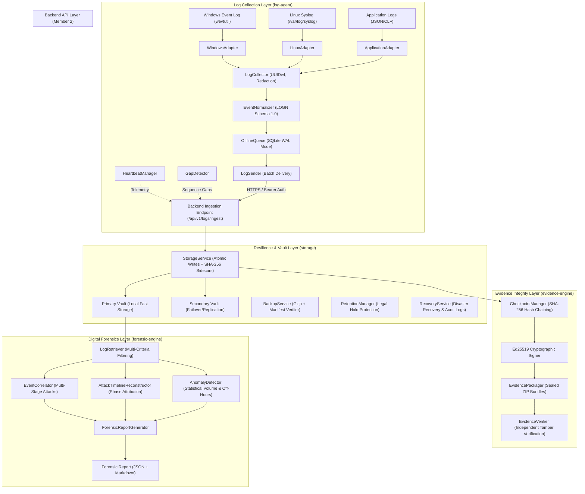
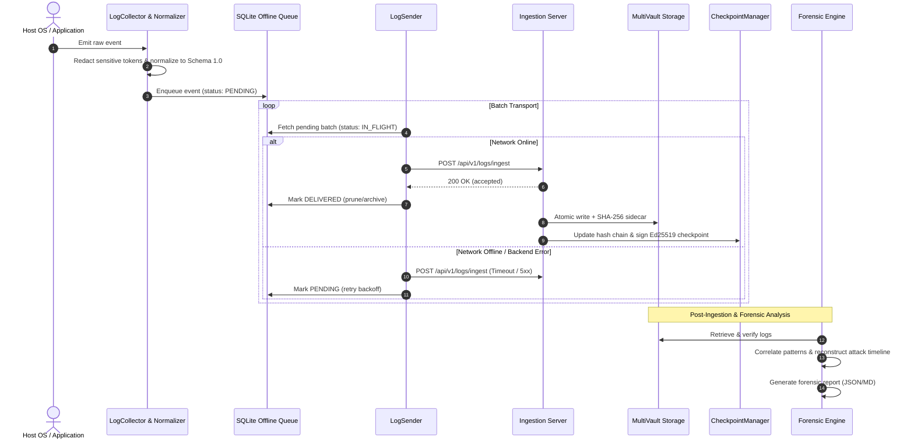
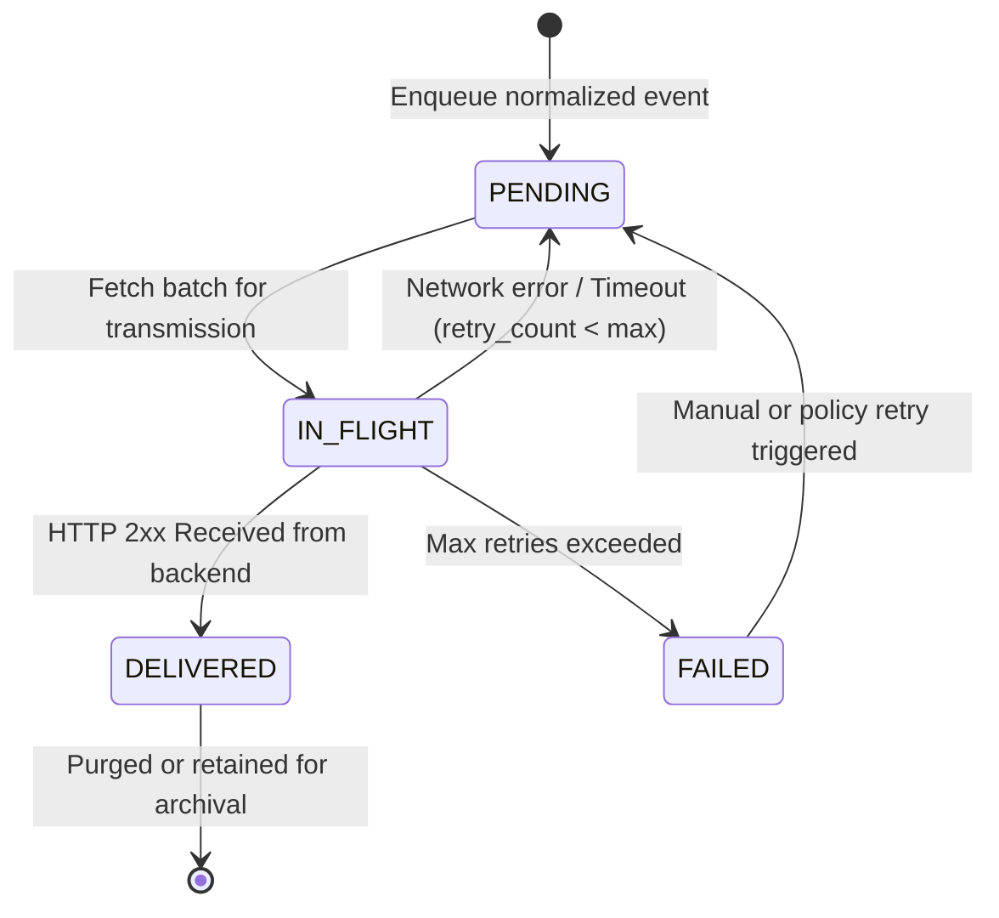

# LOGN Architecture Specification

## 1. Executive Summary

**LOGN** (*Intelligent Log Collection, Secure Storage, Resilience, Backup, Recovery, and Forensic Analysis*) provides an enterprise-grade, cryptographically verifiable log processing and digital forensic pipeline. Designed for high availability, zero-data-loss resilience, and evidentiary defensibility, LOGN ensures continuous ingestion across diverse host platforms, provides tamper-evident storage with asymmetric signatures, and delivers actionable, explainable incident reconstruction.

---

## 2. High-Level System Architecture

---

## 3. Subsystem Breakdown

### 3.1 Log Agent (`log-agent/`)
* **`collector.py` (`LogCollector`)**: Ingests raw events from source systems, assigns deterministic UUIDv4 identifiers, captures microsecond UTC ISO 8601 timestamps, enforces monotonic sequence counters per collector instance, and recursively redacts credentials (passwords, tokens, API keys, private keys).
* **`event_normalizer.py` (`EventNormalizer`)**: Enforces strict LOGN Schema 1.0 data types, standardizes severity levels (`DEBUG`, `INFO`, `WARN`, `ERROR`, `CRITICAL`), categorizes event types (`AUTHENTICATION`, `AUTHORIZATION`, `NETWORK`, `FILE_SYSTEM`, `PROCESS`, `SECURITY`), and parses mixed timestamp formats into uniform UTC strings.
* **`adapters/` (`WindowsAdapter`, `LinuxAdapter`, `ApplicationAdapter`)**: Decouples OS-specific collection mechanisms with transparent fallback simulation for cross-platform portability.
* **`offline_queue.py` (`OfflineQueue`)**: Disk-backed, transactionally durable SQLite queue operating in Write-Ahead Logging (`WAL`) mode with `NORMAL` synchronous pragma. Guarantees zero data loss across process crashes, power interruptions, or transport network failures.
* **`log_sender.py` (`LogSender`)**: Batched HTTP/HTTPS transport client utilizing exponential backoff with jitter and automated state transitions (`PENDING` $\to$ `IN_FLIGHT` $\to$ `DELIVERED`). Retains records in offline storage during backend outages.
* **`heartbeat.py` (`HeartbeatManager`)**: Background daemon providing periodic telemetry reports (`HEALTHY`/`DEGRADED`, queue depths, delivery counters, sequence milestones) to the backend.
* **`gap_detector.py` (`GapDetector`)**: Evaluates event sequence continuity, identifying packet loss, sequence jumps, collector silence, and sequence regressions. Employs non-accusatory, objective analytical models.

### 3.2 Evidence Engine (`evidence-engine/`)
* **`checkpoint_manager.py` (`CheckpointManager`)**: Constructs unbroken cryptographic hash chains:
  $$H_i = \text{SHA-256}(H_{i-1} \parallel \text{canonical}(E_i))$$
  Periodically seals batches using Ed25519 digital signatures.
* **`evidence_packager.py` (`EvidencePackager`)**: Packages log records, cryptographic checkpoints, and verification manifests into sealed, portable zip bundles.
* **`evidence_verifier.py` (`EvidenceVerifier`)**: Performs complete independent mathematical verification of hash chain continuity and asymmetric Ed25519 signatures, pinning exact index locations of deliberate or accidental tampering.

### 3.3 Storage & Resilience Layer (`storage/`)
* **`storageService.js` (`StorageService`)**: Writes evidence files atomically via staging (`.tmp`) and rename operations, simultaneously emitting sidecar `.sha256` checksums to detect disk-level bit rot or manual modification.
* **`backupService.js` (`BackupService`)**: Creates compressed Gzip archives with cryptographically signed manifests and automated restore readiness checks.
* **`multiVault.js` (`MultiVaultStorage`)**: Dual-tier storage coordinator replicating evidence between primary high-performance storage and secondary redundant tiers with automatic read/write failover.
* **`retentionManager.js` (`RetentionManager`)**: Enforces configurable TTL lifecycle policies while strictly safeguarding evidence tagged with `legal_hold: true`.
* **`retrieveLogs.js` (`LogRetriever`)**: Multi-criteria query engine filtering by source, event type, severity, time bounds, and free-text search with automatic checksum validation.
* **`recoveryService.js` (`RecoveryService`)**: Recovers evidence from backup archives with overwrite collision guards, corruption detection, and durable audit logs.

### 3.4 Forensic Analysis Engine (`forensic-engine/`)
* **`event_correlator.py` (`EventCorrelator`)**: Rule-based correlation engine identifying multi-stage attack patterns (e.g., brute force authentication spikes followed by privilege escalation or unauthorized administrative file access).
* **`attack_timeline.py` (`AttackTimelineReconstructor`)**: Orders chronologically normalized events across multiple systems, mapping indicators of compromise to standard MITRE ATT&CK phases (`RECONNAISSANCE`, `CREDENTIAL_ACCESS`, `INITIAL_ACCESS`, `PRIVILEGE_ESCALATION`, `EXECUTION`, `IMPACT`).
* **`anomaly_detector.py` (`AnomalyDetector`)**: Detects off-hours operations, weekend privilege escalations, statistical volume surges, and abnormal error distributions, providing plain-English explanations.
* **`report_generator.py` (`ForensicReportGenerator`)**: Synthesizes forensic findings into executive summaries, chronological timelines, correlated incident chains, statistical metrics, and evidence citations in JSON and GitHub-flavored Markdown.

---

## 4. End-to-End Data Pipeline

---

## 5. Offline Queue State Machine

The SQLite offline queue enforces strict state transitions to guarantee idempotency and avoid duplicates:

Upon agent restart or unexpected crash, `recover_in_flight()` atomically transitions any dangling `IN_FLIGHT` records back to `PENDING`, preventing dropped records.
