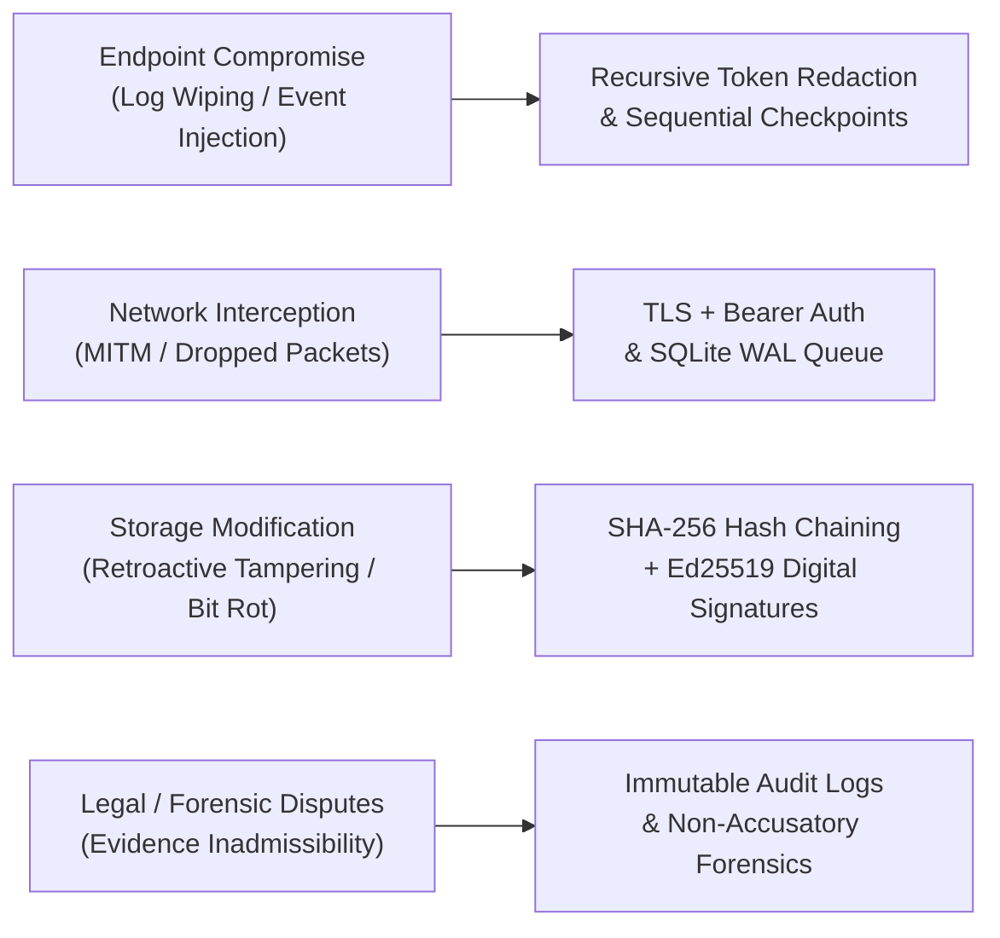

# LOGN Security & Cryptographic Design

## 1. Threat Model & Adversarial Assumptions

The **LOGN** (*Intelligent Log Collection, Storage, Resilience, and Forensics*) architecture assumes an adversarial environment where attackers may possess elevated privileges on host endpoints, network transit visibility, or temporary access to underlying storage media.



### 1.1 Evaluated Threat Vectors
1. **Log Wiping & Truncation:** Adversaries attempting to conceal activity by deleting historical log records or rolling log files.
2. **Retroactive Modification:** An attacker altering audit trail timestamps, IP addresses, or user identities to pin blame elsewhere.
3. **Network Partition & Drop Attacks:** Attackers severing connectivity to drop real-time security alerts.
4. **Credential Leakage in Logs:** Accidental logging of plaintext passwords, bearer tokens, or private keys by upstream applications.
5. **Rogue Agent Injection:** Spoofed collectors attempting to flood the backend with falsified security events.
6. **False-Positive Legal Attribution:** Forensics reports asserting speculative guilt rather than verifiable evidentiary facts.

---

## 2. Cryptographic Integrity Architecture

### 2.1 SHA-256 Hash Chaining
To establish indisputable proof of chronological ordering and forward integrity, each ingested event is linked into a cryptographic hash chain:

$$H_0 = 0000000000000000000000000000000000000000000000000000000000000000_{16}$$
$$H_i = \text{SHA-256}(H_{i-1} \parallel \text{canonical}(E_i))$$

#### Canonical Serialization Rules
To avoid discrepancies resulting from key reordering or whitespace formatting:
* Keys are sorted lexicographically (`sort_keys=True`).
* Extraneous whitespace is eliminated (`separators=(',', ':')`).
* Output is deterministically encoded into UTF-8 bytes before hashing.

```
+---------------+     +---------------+     +---------------+
|    Event 1    |     |    Event 2    |     |    Event 3    |
|   canonical   |     |   canonical   |     |   canonical   |
+-------+-------+     +-------+-------+     +-------+-------+
        |                     |                     |
H0 +----+             H1 +----+             H2 +----+
 |      |              |      |              |      |
 v      v              v      v              v      v
[SHA-256 Hash] ----> [SHA-256 Hash] ----> [SHA-256 Hash] ----> H3 (Root Hash)
      H1                    H2                    H3
```

Any modification, deletion, or insertion of an event at index $k$ alters all subsequent hashes $H_k \dots H_n$, immediately exposing the tampering during verification.

### 2.2 Asymmetric Ed25519 Checkpoint Signatures
While hash chains detect alterations, an attacker with full access to storage could theoretically recalculate the entire chain. To prevent this, the engine uses **Ed25519** asymmetric digital signatures:

1. **Private Signing Key:** Kept securely within the isolated evidence signing process (or hardware security module in production).
2. **Periodic Sealed Checkpoints:** At regular batch boundaries (or upon demand), a checkpoint record is created containing the current root hash, timestamp, record count, and sequence range.
3. **Digital Signature:**
   $$\Sigma = \text{Sign}_{SK}(H_{\text{root}} \parallel \text{timestamp} \parallel \text{record\_count})$$
4. **Verification:** Any external auditor or forensic investigator possessing the corresponding public key $PK$ can mathematically verify $\text{Verify}_{PK}(\Sigma, \dots)$ without needing write access or private keys.

### 2.3 Storage-Level Sidecar SHA-256 Checksums
Every evidence object committed to disk via `storageService.js` is paired with an immutable `.sha256` sidecar checksum:
* Evidence file: `evidence_20261120_101530.json`
* Sidecar file: `evidence_20261120_101530.json.sha256`

Before any log record is retrieved or parsed, the storage layer calculates the current disk hash and compares it against the sidecar. Any discrepancy (due to disk corruption or direct file modification) raises an immediate `TamperDetectedError`.

---

## 3. Sensitive Data Hygiene & Automated Redaction

To prevent sensitive credentials and private keys from entering storage or reports, the `LogCollector` enforces multi-layer recursive redaction prior to queue storage:

### 3.1 Redaction Patterns
The collector scans all strings, message text, and structured payload fields using targeted regular expressions:
* **Passwords & Secrets:** Matches patterns like `password=`, `"secret":`, `passwd:`.
* **API Keys & Tokens:** Matches high-entropy strings and tokens tagged `api_key=`, `access_token=`.
* **Bearer Authorization:** Matches `Bearer [A-Za-z0-9._-]+`.
* **Private Key Headers:** Matches `-----BEGIN [A-Z ]*PRIVATE KEY-----`.

### 3.2 Recursive Payload Sanitization
For nested dictionaries, arrays, or embedded JSON structures, the redaction engine traverses all nodes:
```python
def redact_sensitive_data(val):
    # Dictionaries: recursively sanitize values and redact sensitive keys
    # Lists: recursively sanitize all elements
    # Strings: replace regex match spans with '[REDACTED]'
```

---

## 4. Resilience, Offline Durability & Crash Recovery

### 4.1 SQLite Write-Ahead Logging (WAL)
The collector local queue uses an embedded SQLite database configured with:
* `PRAGMA journal_mode = WAL;` (Enables high-performance concurrent reads and writes).
* `PRAGMA synchronous = NORMAL;` (Ensures filesystem sync on critical transactions).

### 4.2 In-Flight Crash Recovery
To avoid loss of in-flight logs when an agent process is terminated mid-transmission:
* Batches are leased in status `IN_FLIGHT`.
* On agent boot, `recover_in_flight()` queries any dangling `IN_FLIGHT` records and resets them to `PENDING`.
* Guarantees **at-least-once** delivery with zero records dropped.

---

## 5. Non-Accusatory Forensic Analysis Principle

The forensic engine (`EventCorrelator`, `AttackTimelineReconstructor`, `AnomalyDetector`, and `ForensicReportGenerator`) adheres to the principle of **forensic objectivity and defensibility**:

1. **Evidence-Grounded Findings:** All findings explicitly link back to cryptographic event identifiers (`event_id`) and timestamp records.
2. **Objective Analytical Explanations:** Anomalies are phrased quantitatively:
   - *Example:* `"Host alpha logged 14 failed authentication attempts in 42 seconds, representing a 4.5x surge above baseline."*
   - Avoids speculative or accusatory phrasing such as *"Host alpha was hacked by an insider."*
3. **Attribution to MITRE ATT&CK Phases:** Classifies observable indicators into industry-standard taxonomic phases (`RECONNAISSANCE`, `CREDENTIAL_ACCESS`, `INITIAL_ACCESS`, `PRIVILEGE_ESCALATION`, `EXECUTION`, `IMPACT`) while preserving the raw audit trail for courtroom admissibility.
